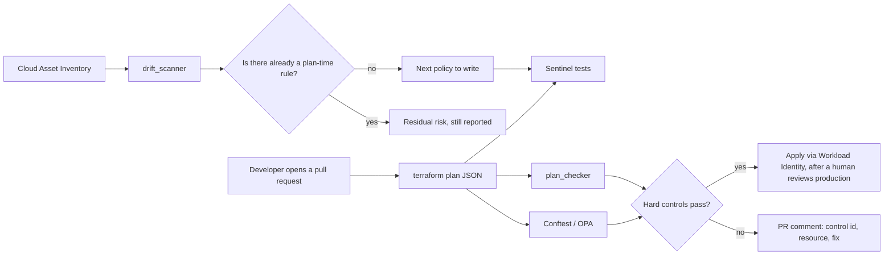

A landing zone is a promise. Folders, a shared VPC, audit logs, a handful of org policies. Six months later someone opens SSH to `0.0.0.0/0` from a side repo, and the promise is a diagram in a wiki.

This repository, [guardrails-gcp](../README.md), is that landing zone plus the machinery that makes the next change fail in CI before it fails in production. It is a portfolio project: a hiring manager can read the README in ten minutes, and a candidate can defend the design for an hour. Nothing in it has been applied to a live GCP organization. Every claim below is something you can re-run on a laptop with no cloud account.

If you want the short version, start with the [README](../README.md). If you want the argument, stay here.

---

## The picture



Five layers, and they are not duplicates of each other:

| Layer | Question it answers | When it runs |
|---|---|---|
| Org policy | Can this API call exist anywhere under this parent? | At the platform, on every request |
| Golden module | Did the author start from a safe default? | When they write Terraform |
| Sentinel and OPA | Does this plan violate a control? | In CI, before apply |
| Drift scanner | Did the live cloud wander away from the plan? | On a schedule |
| Alerts and SQL | Who did it, and when? | After the fact, in the audit sink |

Org policy cannot see a Terraform plan. A plan policy cannot see a click in the console. An alert cannot stop the apply. The project is the set of those three facts wired together.

---

## What "done" means before anyone has a GCP org

The honest constraint is the interesting one. A portfolio cannot assume Cloud Identity, a billing account, or a GitHub environment with reviewers. So the repo is built to be proven offline.

- Every stack is its own Terraform root. `terraform validate` does not need credentials.
- Identifiers are placeholders: `ORG_ID`, `BILLING_ACCOUNT_ID`, `PROJECT_PREFIX`, `GITHUB_ORG/REPO`.
- Sentinel tests use mocks. Rego tests use `opa test`. Python tests use JSON fixtures.
- The demo pull request is a committed `plan.json`, because `terraform plan` needs a project and the demo must run without one.

`make policy-demo` is the five-minute version of the whole idea.

---

## 1. Bootstrap: the state bucket, and the key that does not exist

Terraform state is a map of your production. The bucket that holds it is versioned, uniform-access, public-access-prevention enforced, and `force_destroy = false`. Old versions are capped by a lifecycle rule. Access logs go to a second bucket that is itself not logged, because logging the log bucket is a loop and a bill.

The CI identity is a service account named `sa-terraform-ci`. There is no `google_service_account_key` resource anywhere in the repository. GitHub Actions authenticates with Workload Identity Federation.

```hcl
attribute_mapping = {
  "google.subject"       = "assertion.sub"
  "attribute.repository" = "assertion.repository"
  "attribute.ref"        = "assertion.ref"
  "attribute.actor"      = "assertion.actor"
}

# Forks fail this condition because assertion.repository is the fork, not the upstream.
attribute_condition = "assertion.repository == \"${var.github_repository}\""

oidc {
  issuer_uri = "https://token.actions.githubusercontent.com"
}
```

The service account then trusts only that repository:

```hcl
member = "principalSet://iam.googleapis.com/${google_iam_workload_identity_pool.github.name}/attribute.repository/${var.github_repository}"
role   = "roles/iam.workloadIdentityUser"
```

Why pin the repository and not the git ref? A pull-request plan from `refs/pull/12/merge` is a different `ref` than `refs/heads/main`. If the condition required `assertion.sub == "repo:ORG/REPO:ref:refs/heads/main"`, every review plan would fail, and the only plans that ran would be the ones after merge. That is the wrong time to discover a policy failure. Apply is the dangerous step, and apply is gated by a GitHub Environment named `production` with required reviewers.

Checkov has a rule, CKV_GCP_125, that wants that `sub` equality. Real GitHub tokens do not look like the string the rule wants, so the resource carries a skip comment that says so. A scanner finding you silence without a sentence is a hole. A scanner finding you silence with the reason is a design note.

The first apply cannot store its own state in the bucket it is creating. The runbook says: `terraform init -backend=false`, apply with local state, then `terraform init -migrate-state`. After that, every other stack uses the same bucket and its own prefix.

---

## 2. Org policy, including the case where you have no organization

Twelve constraints, all expressed with `google_org_policy_policy`:

| Constraint | What it stops |
|---|---|
| `iam.disableServiceAccountKeyCreation` | New long-lived JSON keys |
| `iam.disableServiceAccountKeyUpload` | Imported keys |
| `iam.automaticIamGrantsForDefaultServiceAccounts` | The default compute account receiving Editor |
| `compute.vmExternalIpAccess` | Public VM addresses, deny-all |
| `compute.requireOsLogin` | Metadata SSH keys as the way in |
| `compute.skipDefaultNetworkCreation` | The permissive default VPC |
| `compute.disableSerialPortAccess` | A serial console on the VM |
| `compute.requireShieldedVm` | VMs without secure boot, vTPM, and integrity monitoring |
| `storage.uniformBucketLevelAccess` | Object ACLs |
| `storage.publicAccessPrevention` | Public buckets |
| `sql.restrictPublicIp` | Public Cloud SQL |
| `gcp.resourceLocations` | Resources outside an allow list, defaulting to EU and US locations |

The parent is a variable. `scope_type` is `organization`, `folder`, or `project`. A lab with one project still has a real policy stack. A lab with an organization gets inheritance onto every child. That split is [ADR 0004](adr/0004-org-vs-project-scope.md). Custom roles cannot live on a folder, so the IAM stack refuses `folder` as a scope. VPC Service Controls still need an organization access policy, and that stack stays off unless you turn it on.

Exceptions are a map. Each one needs a parent, a reason, and an expiry date of the form `YYYY-MM-DD`. Terraform validation rejects an empty reason. The Org Policy API will not expire the override for you. The date is a review field, and someone has to look at it. Boolean constraints get `enforce = "FALSE"` on the exception parent. List constraints get an allow list, or `allow_all` when the exception means "this folder is unconstrained."

Org policy and IAM are different tools. IAM decides who can call an API. Org policy decides whether the API is willing to do the thing at all, including for someone who has Editor. A deny policy, later, is a third tool: it beats an allow, even an inherited one.

---

## 3. The shape of the estate

When the scope is an organization or a folder, Terraform creates three folders (`prod`, `nonprod`, `shared-services`) and six projects: a logging hub, a network hub, a security tooling project, a sample app in each environment, and a data project. Every project gets `owner`, `env`, `cost-center`, and `data-classification`. Deletion policy is `PREVENT`. APIs are enabled with `disable_on_destroy = false`, because destroying a project service in Terraform is a good way to take down something you forgot the stack owned.

When the scope is a single project, none of those folders are created. The outputs alias the one project you already have. The policies still validate.

---

## 4. The network, and the sentence people mix up

The host project owns a custom-mode VPC. There is no auto-created subnet. Three subnets, one per environment, sit in RFC1918 space. Each has Private Google Access on, and VPC flow logs on, sampled at 0.5 by default. Sampling is a cost dial, documented in the FinOps note. Turning the logs off entirely is the one detective finding that does not yet have a plan-time policy. More on that later.

Ingress starts at deny-all, priority 65534, on a network firewall policy. Two module calls punch the holes that are supposed to exist:

- SSH and RDP from the Identity-Aware Proxy range `35.235.240.0/20`, and only onto instances tagged `iap-ssh`.
- Health checks from the Google health-check ranges, and only onto instances tagged `lb-backend`.

Egress, when `restrict_egress` is true, allows RFC1918 and the private Google API range `199.36.153.8/30` on tcp/443, then denies the rest. A private DNS zone makes `googleapis.com` resolve to `199.36.153.8` through `199.36.153.11`, so clients actually use that VIP. Package mirrors on the public internet do not work until someone adds an explicit allow. That is a tradeoff, written in the network README, not a surprise.

Cloud NAT logs on errors. One NAT in the hub, not one per project.

A firewall rule and a VPC Service Controls perimeter answer different questions.

A firewall rule looks at a packet: source, port, tag. It will happily pass an authenticated `storage.objects.get` from a stolen token, because the packet is allowed and IAM said yes.

A service perimeter looks at the API and the identity. The same call, from outside the perimeter, fails even when the firewall and IAM would have allowed it. The VPC-SC stack in this repo is optional and dry-run. `use_explicit_dry_run_spec = true` and a `spec` block, with no `status` block, means GCP evaluates the perimeter and enforces nothing. You read the violations, then you promote. The perimeter, when you enable it, wraps the data project and restricts `storage.googleapis.com` and `bigquery.googleapis.com`. The sample ingress is a corporate CIDR in TEST-NET-3 (`203.0.113.0/24`), not your real office range.

---

## 5. Logs: what is already on, and what you pay to turn on

Admin Activity audit logs are on in every GCP project. You cannot disable them. They record who changed a firewall, who set an IAM policy, who created a key.

Data Access logs are off until you ask. They record who read a row and who downloaded an object. They are also the line item that surprises people. The logging stack turns on `ADMIN_READ`, `DATA_READ`, and `DATA_WRITE` for `allServices`, with a variable for members to exempt when a pipeline's read volume would dominate the bill. Exclusion filters are the other valve. The aggregated sink, org or folder depending on scope, has `include_children = true` and writes to a partitioned BigQuery dataset and a Cloud Storage archive with a retention policy. Locking that retention is irreversible, so the lock defaults to false.

Six log-based metrics page an email channel:

- `SetIamPolicy`
- firewall create, patch, or delete
- `google.iam.admin.v1.CreateServiceAccountKey`
- org policy changes
- VPC-SC violations (`VpcServiceControlAuditMetadata`)
- changes to sinks or logging config

The same questions are saved as SQL against the export, in `queries/bigquery/`. One of them is the IAM question a SOC analyst actually asks:

```sql
SELECT
  timestamp,
  protopayload_auditlog.authenticationinfo.principalemail AS principal,
  protopayload_auditlog.methodname AS method_name,
  protopayload_auditlog.resourcename AS resource_name,
  resource.labels.project_id AS gcp_project_id
FROM `audit_logs.clou_googleapis_com_activity`
WHERE
  timestamp >= TIMESTAMP_SUB(CURRENT_TIMESTAMP(), INTERVAL 7 DAY)
  AND ENDS_WITH(protopayload_auditlog.methodname, 'SetIamPolicy')
ORDER BY timestamp DESC
```

That shape, a filter plus a time window plus an optional aggregation, is the whole of detection writing. In a vendor language it might be called XQL. Here it is SQL, because the sink this landing zone creates is BigQuery. The dataset name `audit_logs` is a placeholder. These queries were linted with sqlfluff. They were not executed against a live table.

---

## 6. IAM without `roles/editor`

Bindings are groups, from variables. There is no user email in the code.

Two custom roles:

- `customSecurityViewer` can search assets, read logs, read monitoring, and read IAM. It cannot change them.
- `customDeployer` can create the compute and storage objects a pipeline needs, and it can `iam.serviceAccounts.actAs`. It cannot `setIamPolicy`, and it cannot create keys.

One binding is conditional. The deployer on the security project only works while `request.time` is before a timestamp you set, defaulting to the start of 2027. Conditions expire. Standing access does not.

One deny policy, `deny-sensitive-iam`, denies `iam.googleapis.com/serviceAccountKeys.create` and `iam.googleapis.com/serviceAccounts.setIamPolicy` to `principalSet://goog/public:all`, except a break-glass principal you pass in. Deny wins over allow. That is the point of it. The break-glass group is the exception, and it should be small, logged, and annoying to use.

`roles/owner` and `roles/editor` do not appear in the landing zone. The Sentinel policy later makes sure they do not appear in anyone else's plan either.

---

## 7. Golden modules: the paved road

A policy that only fails the bad plan still leaves every author to rediscover the good one. The modules are the good one.

Each module refuses the insecure value in a `validation` block, which means `terraform validate` fails before any policy runs. Cross-variable validation needs Terraform 1.9, so the modules require `>= 1.9.0`. The landing-zone stacks that do not need that stay on `>= 1.6.0`.

The firewall module's opinion is specific. World ingress to port 22, 3389, every TCP port, or protocol `all` does not validate unless you set both `allow_open_admin_ports = true` and a non-empty `justification`. Whitespace does not count. A rule with no target tags and no target service accounts does not validate either, because an untargeted allow hits every instance.

The bucket module always sets uniform access. Public access prevention is `enforced` unless you opt in and justify it. Versioning is on. Location has to be in an allow list. Labels must include `owner`, `env`, and `cost-center`, and `env` must be `prod`, `nonprod`, or `shared`.

The instance module has no `access_config` unless you opt in. Shielded VM is on. OS Login metadata is on. Project-wide SSH keys are blocked. The serial port is off. The service account email is required, and it must not match the default compute pattern `NUMBER-compute@developer.gserviceaccount.com`.

The BigQuery module takes a map of group email to role and rejects `allUsers` and `allAuthenticatedUsers`. The service-account module never creates a key. An optional `wif_member` binds Workload Identity instead. The KMS module rotates every 90 days by default, sets `prevent_destroy` on the key, and refuses to grant admin and encrypter to the same principal.

`terraform test` with a mocked provider proves the insecure inputs fail. That test does not talk to Google.

CMEK is an input, not a default. Requiring a key name before the key exists makes the first apply impossible. The advisory policy is how that control shows up without creating a cycle. Checkov wants CMEK on every bucket and disk. Those checks are skipped with a comment that points at the advisory policy. The comment is the record. The policy is the promotion path.

---

## 8. Sentinel: the policy, the level, and the mock

Sentinel is the language HCP Terraform runs inside a remote plan. The free CLI runs the tests. It does not block a GitHub merge. That distinction is the whole of [ADR 0001](adr/0001-sentinel-and-opa-both.md).

A policy starts as a header a reviewer can read without learning the language. This is the bucket control:

```sentinel
# Control: GCS-001
# Intent: Cloud Storage buckets use uniform access and block public access.
# Risk: Object ACLs and inherited public access are a common data-exposure path.
# Source: CIS Google Cloud Platform Foundation Benchmark (Cloud Storage), NIST 800-53 AC-3, SC-7.
# Enforcement: hard-mandatory. A public or ACL-managed bucket is not an acceptable rollout exception.
# Remediate: use modules/gcs-bucket, or set uniform_bucket_level_access = true and
#            public_access_prevention = "enforced".
# Exception: do not waive this control. If a bucket must be public, stop and talk to security.
```

The body filters `tfplan/v2` down to managed buckets that are not pure deletes, then looks at `change.after`. Unknown values, the `(known after apply)` case, are recorded as their own violation message instead of crashing the policy or silently passing. Deletes are ignored. A resource you are removing is not a resource you are making public.

`print()` runs inside `main` before the boolean result, so a failing test still shows the address and the reason. Sentinel's `and` short-circuits. If you write `rule_a and rule_b` and `rule_a` is false, a test that asserts `rule_b` says the rule was never evaluated. The bucket policy forces both sub-rules into the trace:

```sentinel
main = rule {
  print_violations() and
  (uniform_access or public_access_prevention) and
  uniform_access and
  public_access_prevention
}
```

Tests do not load `sentinel.hcl`. Each test file imports the helper module and mocks the plan:

```hcl
import "module" "common" {
  source = "../../common/functions.sentinel"
}

mock "tfplan/v2" {
  module {
    source = "../../testdata/mock-bucket-compliant.sentinel"
  }
}

test {
  rules = {
    main = true
  }
}
```

`sentinel.hcl` is still the document that says how hard each rule is, for the day you point HCP Terraform at it:

| Policy | Level | Why |
|---|---|---|
| Bucket exposure, open admin ports, public VMs, default compute SA, owner/editor, service-account keys | hard-mandatory | These are incidents, not style |
| Required labels | soft-mandatory | Cost allocation, with an override path |
| CMEK, huge machine types, default Vertex identity | advisory | Real, and not ready to block the estate |

Nine policies, pass and fail fixtures, plus edges for delete, no-op, egress, and unknown values. `sentinel test` passes. The verbose run is checked in at `docs/sentinel-test-output.txt` so a reader can see it without installing Sentinel.

One Sentinel habit that bites: map literals use colons, `strings.contains` does not exist (use `in` or `strings.has_suffix`), and `append` inside a `for` shadows the outer list and then explodes. The label policy stores missing keys in a map for that reason.

---

## 9. OPA: the gate that actually runs on the pull request

The same three controls exist in Rego, against `terraform show -json`. Rego v1, `import rego.v1`, `deny contains msg if`. The message starts with the control id and the resource address, so the person who broke it can fix it without asking in Slack.

```rego
deny contains msg if {
	some rc in input.resource_changes
	rc.type == "google_storage_bucket"
	applies(rc)
	not rc.change.after.uniform_bucket_level_access == true
	msg := sprintf("GCS-001 %s: uniform_bucket_level_access must be true", [rc.address])
}
```

`applies` skips deletes and no-ops. `opa test` covers the pass, the fail, and those skips. `conftest verify` checks the policy bundle. `conftest test tfplan.json -p policies/opa` is the CI gate.

Labels are soft-mandatory in Sentinel and a hard `deny` in Rego. That is deliberate. The offline demo should fail closed. A large estate that cannot tag every resource in one change would move that rule to `warn` and only fail warns on the production policy set. The comment in `labels.rego` says so. Two engines, one catalog id, an explicit difference. Hidden differences are how policy programs rot.

Advisory Rego covers huge machine types and missing CMEK. Conftest does not fail warnings unless you pass `--fail-on-warn`.

If I were choosing for a Terraform Enterprise shop, I would make Sentinel the gate. Enforcement levels and policy sets are what that product is for. If I were choosing for a multi-cloud shop, or a GitHub-only pipeline, I would pick OPA. One language can sit on Terraform plans and on Kubernetes. I would not buy HCP Terraform only to obtain Sentinel. This repo is the second shape, with Sentinel kept so the enforcement-level story is code rather than a slide. The comparison table is [docs/sentinel-vs-opa.md](sentinel-vs-opa.md).

---

## 10. The pull request that is supposed to fail

`examples/non-compliant/` is one violation per file, with a comment naming the policy. The SSH file is the one I would walk through in an interview:

```hcl
# Expected policy: FW-001 (no-open-admin-ports / firewall.rego).
# Ingress SSH from the whole internet.

resource "google_compute_firewall" "ssh_world" {
  name          = "allow-ssh-world"
  network       = "shared-vpc"
  direction     = "INGRESS"
  source_ranges = ["0.0.0.0/0"]

  allow {
    protocol = "tcp"
    ports    = ["22"]
  }
}
```

The module would have refused this at validate time. The raw resource exists so the policy has something to catch, which is what happens when a team does not use the module.

`make policy-demo` evaluates the committed plan fixtures. The compliant plan is quiet. The bad plan prints:

```text
CMEK-001 google_storage_bucket.no_cmek
FW-001   google_compute_firewall.ssh_world
GCS-001  google_storage_bucket.public
IAM-001  google_project_iam_member.editor
LBL-001  google_compute_disk.unlabeled
VM-001   google_compute_instance.exposed
VM-002   google_compute_instance.exposed
```

Conftest fails the three it owns (bucket, firewall, labels) and warns on the missing KMS key. `plan_checker` owns the rest, because those rules were written once in Sentinel and once in Python, and the Python is what CI can run without HCP Terraform.

The fix for the SSH rule is the compliant example: source `35.235.240.0/20`, target tag `iap-ssh`, a description, logging on. There is no exception. A justification string on the module does not bypass the hard-mandatory policy. The troubleshooting doc walks that conversation the way you would walk it with a team that insists the rule is legitimate: reproduce from the plan JSON, name the control and the level, choose fix or exception, add a test, reply on the pull request.

---

## 11. The Python twin, and the scanner that closes the loop

`plan_checker` is the interview exercise. It reads `resource_changes`, ignores deletes and no-ops, and returns findings with a rule id, a severity, an address, a message, and a remediation. `--fail-on high` is the default. Unknown fields become `UNVERIFIED` at low severity. A partial plan should not crash the job, and it should not pretend it saw a value it did not see.

`drift_scanner` is the detective half. Live mode calls Cloud Asset Inventory, `search_all_resources` and `search_all_iam_policies`, through Workload Identity. Offline mode reads a JSON file, which is what the tests and `make drift` use. Tests never open a socket.

Every finding has a catalog id and a boolean, `preventive_exists`. If no org policy, Sentinel rule, or Rego rule covers that id, the report marks a preventive gap.

The closed loop is service-account keys.

1. The scanner sees a key asset with `keyType` of `USER_MANAGED`.
2. That is catalog IAM-003.
3. The preventive set is now the two org policies that forbid creating and uploading keys, the Sentinel policy `no-sa-keys` at hard-mandatory, and the plan checker rule with the same id.
4. The scanner still reports keys that already exist. Org policy does not delete them. Those findings are residual risk. They are not a gap, because the next plan cannot add another one.

The open loop is flow logs. A subnet with logging disabled is NET-002. The network stack turns logs on for the subnets it manages. There is no Sentinel or Rego rule yet for a subnet someone else creates. The report says preventive gap. The next policy to write is a soft-mandatory "flow logs enabled" check. It is not hard-mandatory yet, because the sampling rate is a cost decision and a hard fail on "sampling is 0.1 instead of 0.5" would be the wrong argument.

That loop is [ADR 0005](adr/0005-detective-to-preventive-loop.md). Generating Rego automatically from the scanner is tempting and a good way to ship a false positive for every asset type the scanner only half understands. A person writes the policy and the test. The scanner writes the backlog.

---

## 12. CI, without a JSON key in the repo

The pull-request workflow runs, in order: format and lint, `terraform validate` across a matrix, Checkov and Trivy with SARIF upload, Sentinel, OPA, pytest, `terraform test`, then the offline demo. The demo needs no credentials, and it is the job that proves the guardrails on a fork.

The plan job authenticates with `google-github-actions/auth` and the workload identity provider. If `WIF_PROVIDER`, `WIF_SERVICE_ACCOUNT`, `TF_STACK`, or `TF_STATE_BUCKET` is unset, the job skips with a sentence and the workflow stays green. A fresh clone and a fork should not fail because nobody has created a GCP project yet.

Apply runs on `main`, inside the `production` environment. It plans again, runs Conftest and `plan_checker`, and applies that saved plan. Same skip rule when the variables are absent. Reviewers are configured in GitHub, which is a human step, listed in the runbook and not attempted by the code.

Drift runs Monday at 06:00 UTC, or on demand. With WIF and a scope set, it uploads JSON and HTML and opens or updates one GitHub issue titled "Drift scan findings." Without them, it skips.

`CODEOWNERS` points `policies/` and `landing-zone/` at `@GITHUB_ORG/security`. Create the team, or edit the file, before you require code-owner review. Branch protection is the same list: you turn it on, the repo does not.

---

## 13. Money

Security choices show up on the invoice. The FinOps doc is a table of control, cost driver, and what to turn down:

- Data Access logs are the big one. Exempt the noisy readers, keep Admin Activity, and set a table expiration.
- Retention locks are a compliance decision, not a default.
- One NAT in the hub. Name the egress ranges you allow.
- CMEK is a per-request KMS cost. One key per data class, advisory until the data is actually sensitive.
- Flow-log sampling defaults to half. Drop metadata on chatty subnets. Leave the logs on.
- Security Command Center Premium is a paid detective product this repo does not enable. Buy it when the organization is real. Keep the plan-time gates either way.

The budget resource alerts at 50, 80, and 100 percent through Pub/Sub. The BigQuery billing export is created in the console, not in Terraform, and `billing_by_label.sql` groups it by `cost-center` and `env`. Those labels are the same ones LBL-001 requires. Presence is enforceable. Whether someone tagged a bucket of customer documents as `public` is not, which is the next section.

---

## 14. Two controls I refused to automate

The catalog has the feasibility test: can you read the bad state from config or from an inventory API, is the source reliable on a partial plan, what does a false positive cost, is the fix obvious, who owns the exception, and is this a plan-time fact or a runtime fact?

**The classification label is accurate.** LBL-001 can require `owner`, `env`, and `cost-center`, and it can require `env` to be one of three words. It cannot know that the objects in the bucket are customer data. The bytes are not in the plan. A reviewer, or a DLP job, owns accuracy. Automating presence and leaving truth to a human is the split that stays honest.

**Least privilege is appropriate.** IAM-001 can ban `roles/owner` and `roles/editor`. It cannot decide that `roles/compute.admin` is the right size for a deploy pipeline. Appropriate depends on the job. The custom roles are a reviewed baseline. An allow-list of every acceptable role would freeze the platform in week one.

Everything else in the catalog, more than thirty rows, names a mechanism: org policy, Sentinel, Rego, the scanner, or an alert. The full table is [docs/policy-catalog.md](policy-catalog.md).

---

## 15. The agent, with the exploit left out

The Vertex stack is off unless `enable_ai_workload` is true. When it is on, it creates a service account with `roles/aiplatform.user`, no key, and an optional egress rule to the private Google API range. It does not deploy a model. The threat model is the design review for turning it on.

The interesting row is indirect prompt injection. A model that can call tools will eventually read a document, a ticket, or a web page. That text can contain instructions aimed at the model. The model then calls a tool as if the user had asked. The control is not a clever prompt. The control is a narrow tool list, a service account that cannot set IAM or create keys, egress that can only reach the private Google range plus names you listed, a human on any destructive tool, and audit logs of the tool calls. Prompts that contain customer data do not belong in a world-readable sink. Redact them, or drop that stream from the long-term archive with the logging exclusion variable.

Direct prompt injection, excessive agency, and secrets pasted into a context window are in the same table, each mapped to an IAM binding, a perimeter, an egress rule, or a log. The write-up stays at that level. Payloads are not the portfolio.

---

## 16. Rollout, if this were 500 projects

Advisory, then soft-mandatory, then hard-mandatory. Promote a level when, for two weeks, fewer than 5% of changed resources violate it, fewer than 10 exceptions are open, none are past their expiry, and the error message names the resource and the fix. Demote if a false positive blocks a production incident, and add the fixture before you promote again.

Tag the policy set with semver. Staging runs the next tag. Production stays on the current tag. Branches are not a second source of truth.

At 500 projects and 50 teams: one org policy at the organization, folder exceptions with a date, the same Conftest bundle pinned by tag in every pipeline, drift run per folder rather than one unbounded asset search of the whole org, and one CI service account per environment, still via Workload Identity, still without a key. State stays split by stack. One state for 500 projects is how you learn to fear a lock.

---

## Run it

```bash
python3 -m venv .venv
.venv/bin/pip install -r tools/requirements.txt
make test
make policy-demo
make drift
```

You need Terraform, Sentinel, OPA, and Conftest on `PATH` for the full test run. Versions that were used to build this are in [docs/HANDOFF.md](HANDOFF.md): Terraform 1.16, Google provider 8.6, Sentinel 0.41, OPA 1.21, Conftest 0.71. `make help` lists the rest, including the Checkov and Trivy scan.

Applying it is a different afternoon. [docs/runbook.md](runbook.md) is the list: create the project, log in, copy the tfvars examples, apply bootstrap with a local backend, migrate state, then the other stacks in order. Destroy in reverse. KMS keys have `prevent_destroy`. Retention locks, if you turned them on, will refuse to go away. Project deletion policy is `PREVENT` on purpose.

---

## What I would say in the room

The landing zone is the easy part to draw. The part that matters is the closed loop: a live user-managed key became an org policy and a hard-mandatory plan rule, and the scanner still reports the keys that are already out there. The open loop is flow logs, and I can point at the flag that says the preventive control does not exist yet.

Sentinel shows I can write the HashiCorp policy language, including the mocks and the enforcement levels. Conftest shows I know the level does not block anyone until it runs in a place developers cannot skip. I would pick OPA for a multi-cloud shop and Sentinel for a Terraform Enterprise shop, and I can say why without pretending they are the same product.

I would also say what this repo is not. It has not been applied. CMEK is advisory. The perimeter is dry-run. Sentinel does not fail the GitHub check. Those are choices, written down, not gaps I hope nobody asks about.

---

## Where to click next

| If you want | Open |
|---|---|
| The ten-minute tour | [README](../README.md) |
| Diagrams of the network and the log path | [architecture](architecture.md) |
| Every control, and the two that stayed manual | [policy catalog](policy-catalog.md) |
| Sentinel versus OPA | [sentinel-vs-opa](sentinel-vs-opa.md) |
| The blocked-deploy conversation | [troubleshooting](troubleshooting-blocked-deployments.md) |
| How a finding became a policy | [ADR 0005](adr/0005-detective-to-preventive-loop.md) |
| The agent threat model | [threat model](threat-model-agentic-ai.md) |
| Talking points mapped to files | [interview notes](interview-notes.md) |

The screenshots worth taking, once a pull request exists, are the failing demo on `open_ssh.tf`, the green run on the compliant example, and the drift report with NET-002 marked as a gap. The terminal output above is what those shots should show.
